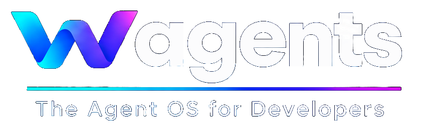
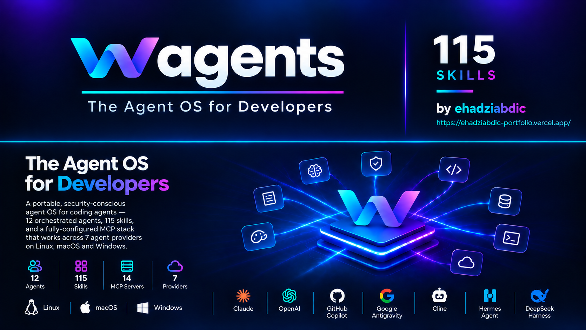

<div align="center">



# WAgents

**The complete, ready-to-clone WAgents home setup: 3 main agents, 13 specialists, 300+ skills, Telegram remote control, Drive bridge, training watchers, optional Hex voice dictation, and agents that drive your real Brave. Hand the repo link to your agent and it does the rest.**

[](LICENSE)
[](https://github.com/sponsors/ehadziabdic)
[](https://buymeacoffee.com/ehadziabdic)


*OpenCode-first - Brave-only - Tailscale-only remote - session-only operation - placeholders only in git*

</div>

---

## Table of contents

- [Why this repo](#why-this-repo)
- [What's inside](#whats-inside)
- [Quick start](#quick-start)
- [Using it day to day](#using-it-day-to-day)
- [Security model](#security-model)
- [Harness portability](#harness-portability)
- [Docs](#docs)
- [Repository structure](#repository-structure)

---

## Why this repo

A fresh Windows machine goes from zero to the exact setup this was
built on: same agents, same skills, same runtime wiring, same Telegram
bot, same watchers, dictation by voice, agents in your real browser.

This public edition ships the complete agent pack, skills, scripts, and
configuration structure with placeholders instead of live credentials.
Provider keys, OAuth tokens, the Telegram bot token, and the Drive
remote are never committed here. Fill the placeholder files locally
during install, or let the installer and OAuth flows create them. The
private edition keeps real values for multi-device sync; this repo
keeps the same layout without the secrets.

| | What you get |
|---|---|
| **3 main agents** | Build (implements), Plan (chat/plan only), Unrestricted (user-selected only) |
| **13 specialists** | frontend, backend, security, cybersec (PentAGI), reviewer, debugger, QA, research, docs, ML, devops, CV, harness |
| **300+ skills** | `think-*` workflow family, design/taste, docs formats, LLM/ML/DevOps packs, Figma/MCP builders, scientific archive (installed skill count matches this machine's 149 advertised subset plus the full archive) |
| **Telegram remote** | `/shot /status /ls /get /drive /zip /unzip /clip /upload /photo /voice` + free-text runs in chat + voice runs in chat |
| **Hex voice dictation (optional)** | hold-to-talk voice typing in any app; not installed automatically - one manual command: `irm https://anoma.ly/hex/install-windows.ps1 \| iex` |
| **OpenCode Browse** | agents drive your real Brave with your logins/extensions; background tabs, handoffs for 2FA/payment, redacted HAR, screen recording. Auto-installed |
| **Training watchers** | JupyterHub poller (SSO-aware), heartbeat inbox, hourly retention sweep |
| **MCP stack** | always-on: context7, tavily, playwright, scrapling, codebase-memory, iris, browse; wake-on-demand: 21st, excalidraw, github, figma, sentry, airtable, notion, huggingface, markitdown, canva, rea, vercel (OAuth, no inline tokens) |

---

## Quick start

You can install everything yourself with three commands (below), or just
hand the repo link to your agent and let it drive. The agent path is the
supported one.

**Agent-driven (recommended)**

1. Install OpenCode Desktop: `winget install SST.OpenCodeDesktop`.
   Launch it once so the background service and firewall rules exist.
2. Clone this repo into the project folder the agent should work in:
   `git clone https://github.com/ehadziabdic/WAgents.git`
3. Open a NEW opencode chat, paste the repo link into it with one line:

   ```text
   Set up WAgents on this machine from https://github.com/ehadziabdic/WAgents.
   Follow the repo's README and docs/AGENT-SETUP-PROMPT.md exactly.
   ```

   The agent reads `docs/AGENT-SETUP-PROMPT.md` (instructions written for a
   fresh machine), fills the placeholder credentials, runs `install.ps1`
   elevated, installs every tool - Python, Node, Tailscale, rclone,
   Brave, Browse (Brave agent driver) - then walks you through the
   manual confirmations (Tailscale approval, Telegram chat ID, JupyterHub
   token, Brave Web Store "Add to Brave"). Hex (voice dictation) is
   optional and NOT installed automatically; install it by hand with
   `irm https://anoma.ly/hex/install-windows.ps1 | iex` if you want it.

**Manual (same steps, no agent)**

```powershell
git clone https://github.com/ehadziabdic/WAgents.git WAgents; cd WAgents
.\install.ps1   # run from an elevated PowerShell
```

---

## Using it day to day

- **From your phone (Telegram):** `/status` for the PC, `/get` a file,
  `/drive` it to Drive, `/shot` the screen, talk and it transcribes.
- **Training:** spawn on JupyterHub, the watcher reports crashes and
  state changes; ask for epoch snapshots any time.
- **Browser work:** ask for something on a site where you are signed in
  ("check my Gmail", "open the Linear board"); the agent opens background
  tabs in Brave and does it, handing 2FA/payments back to you.
- **Voice dictation (optional):** if you install Hex by hand, hold your
  Hex hotkey, speak, release; text lands in the focused field, including
  in the agent chat box.
- **Design:** ask for a Figma design, get a screenshot back in Brave.
- **Second brain:** Notion + Obsidian vault are readable in chat.

---

## Security model

No real secrets are committed. These files ship as templates and must be
filled locally:

| File | Placeholder |
|---|---|
| `opencode/opencode.json` | Vercel, Context7, and GitHub tokens |
| `opencode/service.json` | `CHANGE-ME` server password |
| `opencode/.wagents/secrets/opencode-accounts.json` | provider account keys and labels |
| `local-share/auth.json` | provider API keys and OAuth tokens |
| `local-share/account.json` | provider account registry |
| `local-share/credentials.json` | credential rows used by `import-credentials.ps1` |
| `local-share/credentials-reference.json` | orphaned/legacy credential reference |
| `local-share/mcp-auth.json` | MCP OAuth tokens |
| `telegram/.telegram.env` | bot token and allowed chat ID |
| `rclone/rclone.conf` | Drive OAuth token |

Replace placeholders on your machine, keep the real values out of git,
and rotate anything that was ever exposed. `opencode/aboutme.md` and the
separate `jailbreaks/` prompt collection are not part of this public
repo. The installer still provides the resolver and the model map for
`[WAgent] Unrestricted`; supply the prompts with
`.\install.ps1 -JailbreaksRepo <url>` or clone them into
`~/.config/opencode/jailbreaks` yourself. See [`SECURITY.md`](SECURITY.md)
for reporting.

---

## Harness portability

Built opencode-first, portable by design: agents, skills, commands,
scripts, and the bot core are harness-agnostic. Five small seams
(session bridge, session IDs, MCP file, installer, config default) are
documented in [`docs/HARNESS.md`](docs/HARNESS.md) with the exact
per-harness swap for Codex, Claude, and Copilot.

---

## Docs

| Doc | Contents |
|---|---|
| [`docs/SETUP.md`](docs/SETUP.md) | fresh-machine guide + manual steps with reasons |
| [`docs/AGENT-SETUP-PROMPT.md`](docs/AGENT-SETUP-PROMPT.md) | paste-into-chat installer prompt (agent path, incl. action-request pattern) |
| [`docs/HARNESS.md`](docs/HARNESS.md) | Codex/Claude/Copilot portability seams |
| [`telegram/README.md`](telegram/README.md) | bot commands and files |

---

## Repository structure

```text
WAgents/
├─ opencode/        agents (16), skills (300+), commands, instructions,
│                    schedules, scripts, service config,
│                    opencode.json (merged config; includes the browse MCP
│                    server and placeholder provider tokens)
│                    (.wagents/, inbox, plans, reminders regenerate locally)
├─ local-share/     auth.json, mcp-auth.json, account.json (placeholders)
├─ telegram/        bot, envs, operator tools, requirements, README
├─ rclone/          Drive remote config (placeholder token) + notes
├─ pictures/        logo + banner
├─ docs/            SETUP, AGENT-SETUP-PROMPT, HARNESS
├─ install.ps1      installer (elevated PowerShell); Browse
│                    auto-installs in stage 5d; Hex is a manual install
└─ AGENTS.md        global rules copy
```

---

<p align="center">
  
</p>

---
